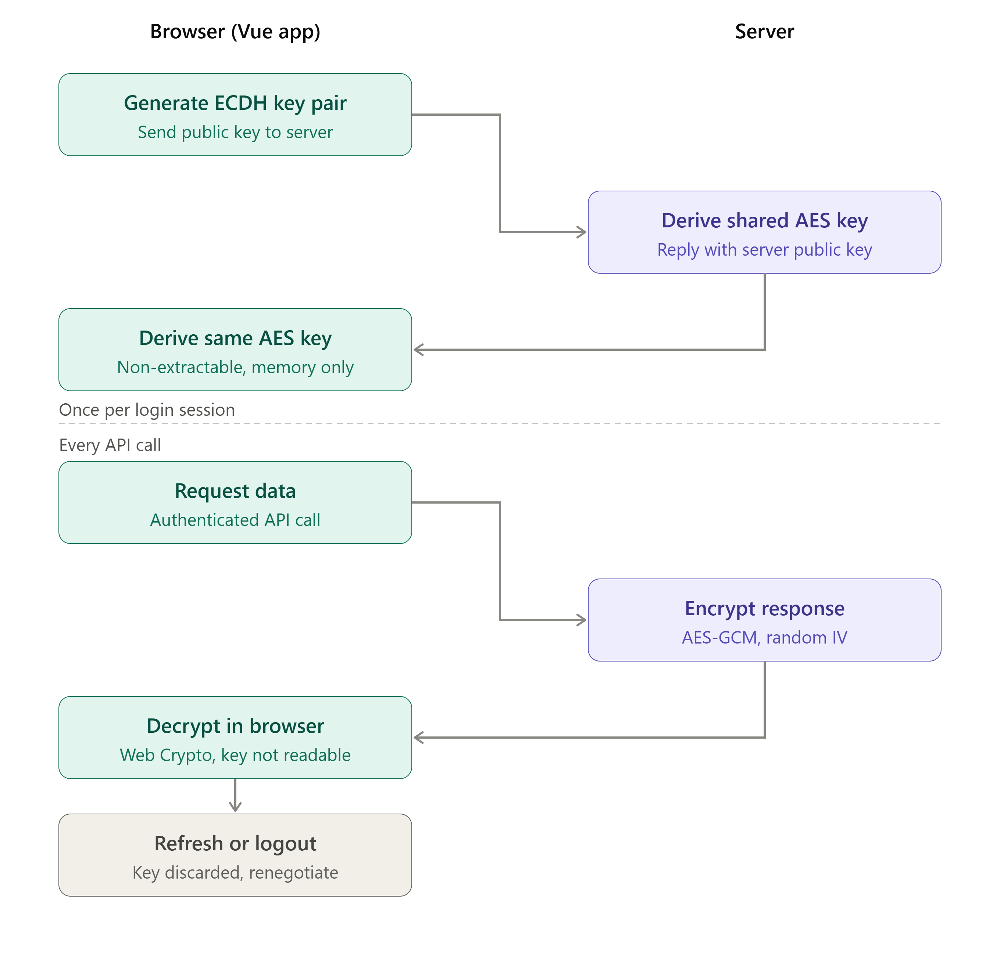

# ECDH session key POC

Express API + Vue 3 frontend, in one pnpm workspace. ECDH P-256 handshake once per
login; every request and response after that is AES-256-GCM encrypted under the
derived key, and the key can be rotated without losing the session.



```
apps/
  server/   Express API, :3001, sessions in memory
  web/      Vue 3 + Vite, :5173, proxies /api to the server
```

The browser only ever talks to one origin (the Vite dev server), so cookies and
`crypto.subtle` both just work.

```sh
pnpm install
pnpm dev          # http://localhost:5173
```

`pnpm dev` runs both packages in parallel; `pnpm dev:web` / `pnpm dev:server`
run one side.

## Flow

| Step | Where | Code |
|---|---|---|
| Generate ECDH pair, send public key | browser | `apps/web/src/App.vue` `negotiate` |
| Derive AES key, reply with server public key | server | `apps/server/index.js` `/api/handshake` |
| Derive same AES key (non-extractable, memory only) | browser | `crypto.subtle.deriveKey(..., false, ['encrypt', 'decrypt'])` |
| Encrypt request body: AES-GCM, random IV, per-session `seq` | browser | `seal` |
| Decrypt request, reject a `seq` that doesn't move forward | server | `openRequest` |
| Encrypted response: AES-GCM, random IV, `{iv, data: ct‖tag}` base64 | server | `encrypt()` |
| Decrypt via Web Crypto | browser | `unseal` |
| Rotate: fresh ECDH pairs both sides, reply under the old key | both | `/api/rekey`, `rotate` |
| Logout drops key + session, next call renegotiates | both | `/api/logout` |

## Verify

- Click **Request encrypted data** twice: `iv`/`data` differ each time, and the wire panel only ever shows ciphertext — the request body is `{iv, data}` too.
- DevTools Network: the request payload is opaque; the console's derived `CryptoKey` is non-extractable.
- **Rotate key**, then **Request encrypted data**: still decrypts, log shows the rotation, and replaying an old ciphertext now fails.
- **Logout**, then **Request encrypted data**: a fresh handshake happens transparently.
- `curl -X POST localhost:3001/api/handshake -d '{}' -H 'content-type: application/json'` → 400.
- `curl -X POST localhost:3001/api/data` → 401.
- Re-posting the exact same encrypted body → 409 `stale or replayed request`.

## POC limits (not production)

- Sessions live in a `Map`: lost on restart, unbounded (no TTL), single instance.
- Plain HTTP here; Web Crypto ECDH requires a secure context (`localhost` qualifies) — use HTTPS in real deployments.
- The request counter is per session and only has to move forward: gaps are tolerated (a lost request can't wedge the client) and there is no timestamp or window.
- Rotation is manual (button / `POST /api/rekey`); there is no schedule, and in-flight requests still under the old key fail after the swap.
- Auth is whatever the handshake proves — nothing. Add real user auth alongside it.
